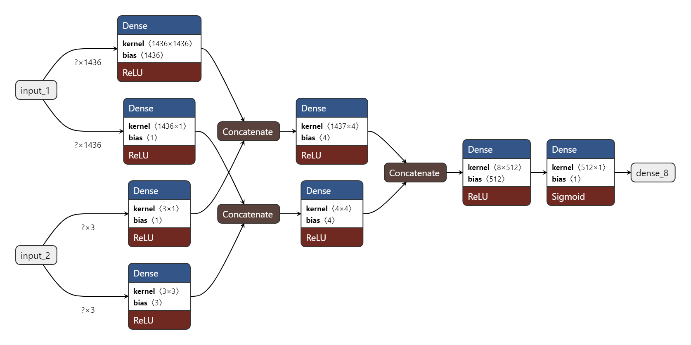

# Prédiction de disponibilité de Vélib' (Juin 2022)

Collecte automatique de données de l'API Vélib' Métropole, entraînement d'un réseau de neurones pour prédire la disponibilité future des vélos, et affichage des prédictions via une interface web + API.

### Scraping (VPS + Raspberry Pi)

Collecte synchronisée sur deux machines :
- **VPS** : Interroge l'API Vélib' toutes les minutes et enregistre les logs en local.
- **Raspberry Pi** : Récupère périodiquement les logs, vérifie l'intégrité des données et les stocke sur un disque dur à domicile.

Détecte les échecs de requête et les sauts temporels croisant les logs, puis envoie des alertes IFTTT en cas d'erreur.

### Réseau de neurones pour la prédiction

Pour ce projet, compte tenu des ressources disponibles, nous avons fait le choix de ne prédire la disponibilité de vélos que pour une seule borne. Cela nous a permis de réduire considérablement la taille du réseau et de pouvoir l'entraîner en un temps raisonnable sur un laptop.

- **Entrées** (données et métadonnées) :
    - Couche dense traitant l'état de 1436 stations (taux d'occupation)
    - Couche dense traitant l'heure du log correspondant (jour de la semaine, heure, minute)
- **Sortie** :
    Ratio du nombre de vélos disponibles à la station cible (ici prédéfinie).

Le modèle est entraîné sur un historique de 5 mois de captures ininterrompues, avec un offset permettant de prédire l'état à +5 ou +10 minutes (temps de marche jusqu'à la borne choisie).

**Architecture du modèle** :

### API 

Endpoint FastAPI exposant les prédictions en temps réel.

L'API interroge l'API Vélib' en direct, normalise les données, et les transmet au modèle pré-entraîné pour obtenir une prédiction instantanée, mise en cache pendant 60 secondes.

### Interface web

Web-app minimaliste affichant pour une borne spécifique :
- **État actuel** : Nombre de vélos et places libres
- **Prédiction (+5 min)** : Estimation future, mise à jour automatiquement.

L'interface cible les usagers souhaitant anticiper la disponibilité avant de se déplacer vers une station. 

### Cartes et visualisations

Scripts de visualisation des données :
- **Cartes** de disponibilité par station
- **Heatmaps** des patterns d'occupation quotidiens et hebdomadaires
- **Vidéos d'évolution** de l'état du réseau dans le temps